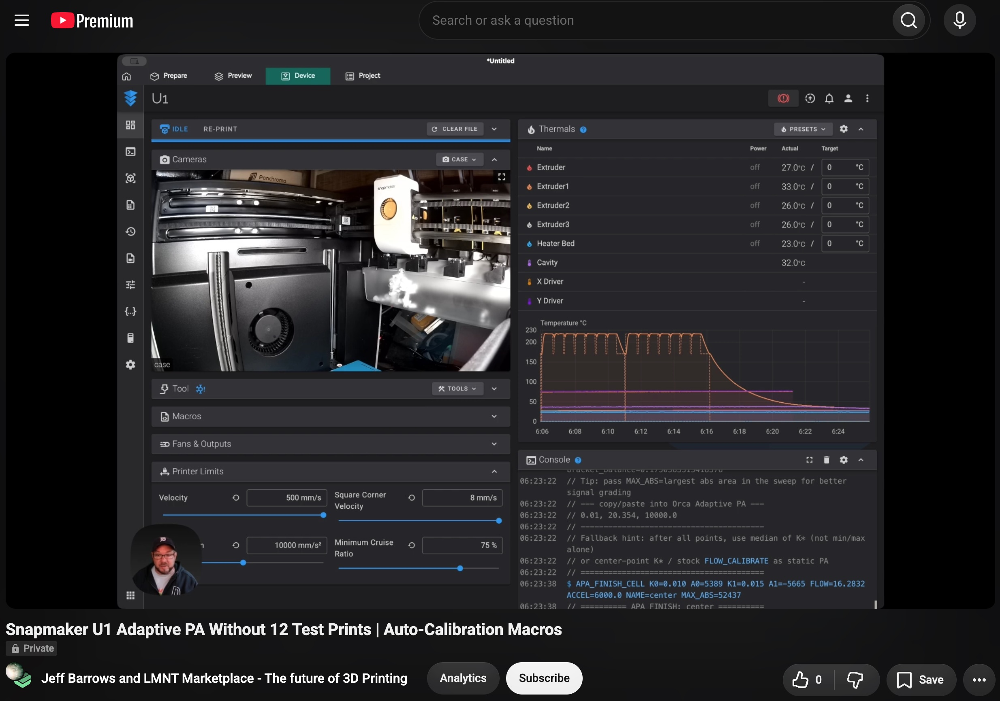

# U1 Adaptive Pressure Advance Auto Calibration

<p align="center">
  <a href="https://www.youtube.com/watch?v=TzlhBpQkZEI">
    
  </a>
</p>

**Sensor-driven OrcaSlicer Adaptive Pressure Advance tables generator for the Snapmaker U1.**

Uses the U1’s stock inductance flow sensor and `FLOW_MEASURE_K` (pure-E velocity steps + residual `area`) so you can build Adaptive PA rows **without** printing and scoring line tests. Klipper macros only — no firmware fork required.

```text
PA, flow_mm3_s, accel_mm_s2
```

## Docs & video

| | |
|--|--|
| **Blog post** | [Snapmaker U1 Adaptive Pressure Advance auto-calibration](https://garagenotes.lmnt.co/Snapmaker-U1-Adaptive-Pressure-Advance-auto-calibration.html) |
| **YouTube** | [Walkthrough](https://www.youtube.com/watch?v=TzlhBpQkZEI) (thumbnail above) |
| **User guide** | [docs/USER_GUIDE.md](docs/USER_GUIDE.md) |

## What’s in this repo

| Path | Purpose |
|------|---------|
| [`adaptive_pa_macro.cfg`](adaptive_pa_macro.cfg) | Klipper gcode macros (box-style 5-point suite + finish helpers) |
| [`docs/USER_GUIDE.md`](docs/USER_GUIDE.md) | Install, quick start, presets, troubleshooting, command reference |
| [`docs/METHODOLOGY.md`](docs/METHODOLOGY.md) | Residual `area`, box design, confidence scoring, kinematics |
| [`docs/COIL_DATA_CAPTURE.md`](docs/COIL_DATA_CAPTURE.md) | Optional coil frequency capture and waveform analysis |
| [`scripts/apa_autocal.py`](scripts/apa_autocal.py) | Runs the suite over Moonraker and finishes every point automatically (Orca rows + fallback PA) |
| [`scripts/coil_dump_client.py`](scripts/coil_dump_client.py) | Optional coil frequency capture / plot (Moonraker or UDS) |
| [`tests/`](tests/) | Tests for the automation script and macro math (see [Running tests](#running-tests)) |
| [`docs/images/`](docs/images/) | README/YouTube thumbnail + example coil scope captures |

## Quick install (printer)

1. Copy `adaptive_pa_macro.cfg` onto the printer (e.g. next to `printer.cfg`, or into a config subdirectory).
2. Include it in your `printer.cfg` and restart Klipper:

```ini
[include adaptive_pa_macro.cfg]
```

   On paxx12 extended firmware, put the file in `config/extended/klipper/` instead: it is included automatically and survives firmware updates, which rewrite `printer.cfg`.

## Quick start: Using Printer Macros (Fluidd / Mainsail)

1. Run a full suite (example: tool 0, 220 °C):

```gcode
APA_COIL_RUN_ALL EXTRUDER=0 TEMP=220
```

2. For each test point, find the `area` sign flip and run `APA_FINISH_CELL` / `APA_FINISH_LAST` as described in the [user guide](docs/USER_GUIDE.md).
3. Paste the resulting rows into OrcaSlicer → Filament → Adaptive pressure advance.

Full walkthrough: **[docs/USER_GUIDE.md](docs/USER_GUIDE.md)** · narrative write-up: **[blog](https://garagenotes.lmnt.co/Snapmaker-U1-Adaptive-Pressure-Advance-auto-calibration.html)**.

## Quick Start: Fully Automated Run and Calculations (local computer)
This script runs the same macros as above by calling the printer directly from your local computer, automatically parse the results and generate the Adaptive Pressure Advance table so you don't have to! (See User Guide for more information)

From a computer on the same network and Python 3.9+:

```bash
pip install -r requirements.txt
python3 scripts/apa_autocal.py --host PRINTER_IP --tools 0 --temp 220
```

OR

Optionally you can use [uv](https://docs.astral.sh/uv/) (installs Python and dependencies automatically):

```bash
uv run scripts/apa_autocal.py --host PRINTER_IP --tools 0 --temp 220
```

The script runs the 5-point suite, reads every `area` value from Moonraker, re-runs points whose sweep missed the zero crossing, and prints the paste-ready OrcaSlicer rows plus a fallback static PA. Results are saved to `apa_results/<timestamp>/`; add `--filament "Polymaker PLA Pro"` to tag them with the filament name. Details: [user guide §2](docs/USER_GUIDE.md#2-automated-run-recommended).

## Optional: coil waveform capture

Console `area` lines are enough for calibration. To plot raw coil frequency while a test runs (laptop-friendly via Moonraker):

```bash
python3 -m venv .venv
source .venv/bin/activate
pip install -r requirements.txt

python3 scripts/coil_dump_client.py \
  --moonraker http://PRINTER_IP \
  --sensor extruder2 \
  --name apa_center_t2
```

Then run `APA_COIL_*` in Fluidd; press Enter when the point finishes. See **[docs/COIL_DATA_CAPTURE.md](docs/COIL_DATA_CAPTURE.md)**.

## Requirements

- Snapmaker U1 (or compatible stack) with working `[flow_calibrator]` / inductance coil flow sensing
- Stock `FLOW_MEASURE_K` / `FLOW_CALIBRATE` (no custom Klipper Python required for the macros)
- OrcaSlicer Adaptive Pressure Advance table support
- Automation script: Python 3.9+, `websockets` (or just `uv`)
- Optional coil client: Python 3.8+, `numpy`, `matplotlib`

## Running tests

```bash
uv run --no-project --with pytest --with jinja2 --with "websockets>=14" pytest tests
# or: pip install pytest jinja2 websockets && python -m pytest tests
```

`jinja2` renders the real macros from `adaptive_pa_macro.cfg` to check the Python scoring and the envelope math against them; `websockets` runs the end-to-end test against a mock Moonraker.

## License

This project’s macros, documentation, images, and client are licensed under the **GNU General Public License v3.0** — see [LICENSE](LICENSE).

Klipper, Snapmaker firmware, Moonraker, and OrcaSlicer remain under their own licenses. This repository does not relicense those projects.

## Credits & related work

- Snapmaker U1 flow calibrator / inductance coil residual measurement (`area`)
- [OrcaSlicer Adaptive Pressure Advance](https://github.com/OrcaSlicer/OrcaSlicer/wiki/adaptive_pressure_advance_calib)
- Inspired by the broader PA tuning ecosystem (e.g. CNC Kitchen / PrusaPATuner-style visualization), adapted here for U1 sensor auto-cal and Adaptive PA *tables*

## Disclaimer

Community tooling for research and tuning. Verify results on your machine and filament. Not affiliated with Snapmaker or OrcaSlicer.
